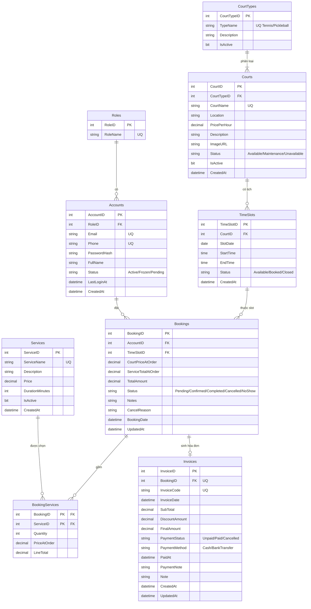

# ERD — SportZoneDB (bản chuẩn duy nhất)

**Hệ thống:** Quản lý tổ hợp sân Tennis + Pickleball
**Database:** `SportZoneDB`
**Nguồn chân lý:** `sql/01_SportZoneDB_Schema.sql` (cột + ràng buộc) — tài liệu này luôn bám theo schema
**Cập nhật:** 2026-08-17
**Bản cũ:** từng được lưu trong `erd-archive/` để truy vết nhưng không có trong working copy hiện tại; **không dùng**

> **9 thực thể, 8 quan hệ.** Đây là bản đầy đủ nhất: mọi cột + kiểu dữ liệu + ràng buộc + cardinality + hướng dẫn vẽ.
>
> **Thay đổi quan trọng so với bản cũ (17/08/2026):** bỏ `Bookings.CourtID` và quan hệ trực tiếp `Courts → Bookings` (dư thừa, vi phạm 3NF — sân của booking suy ra qua `TimeSlot`); `BookingServices` dùng PK composite `(BookingID, ServiceID)` thay khóa surrogate. Chi tiết ở mục 7 và 8.

---

## 1. Tổng quan

| # | Entity (Bảng) | Tiếng Việt | PK | FK |
|---|---------------|-----------|----|----|
| 1 | `Roles` | Vai trò | RoleID | — |
| 2 | `Accounts` | Tài khoản | AccountID | RoleID |
| 3 | `CourtTypes` | Loại sân | CourtTypeID | — |
| 4 | `Courts` | Sân | CourtID | CourtTypeID |
| 5 | `TimeSlots` | Khung giờ | TimeSlotID | CourtID |
| 6 | `Services` | Dịch vụ phụ | ServiceID | — |
| 7 | `Bookings` | Đặt sân | BookingID | AccountID, TimeSlotID |
| 8 | `BookingServices` | Dòng dịch vụ của booking | (BookingID, ServiceID) | BookingID, ServiceID |
| 9 | `Invoices` | Hóa đơn | InvoiceID | BookingID |

**Ký hiệu dùng trong bảng thuộc tính:**

- **PK** = Primary Key (khóa chính)
- **FK** = Foreign Key (khóa ngoại), ghi rõ trỏ tới bảng nào
- **UQ** = Unique (duy nhất)
- **CK** = Check constraint (ràng buộc giá trị)
- **DF** = Default (giá trị mặc định)
- **IDENTITY(1,1)** = tự tăng từ 1, bước 1

---

## 2. Thuộc tính từng thực thể (đầy đủ)

### 2.1. ROLES — Vai trò

**PK:** `RoleID`

| Cột | Kiểu dữ liệu | Ràng buộc | Ghi chú |
|-----|--------------|-----------|---------|
| `RoleID` | INT | **PK**, IDENTITY(1,1) | Khóa chính |
| `RoleName` | NVARCHAR(50) | NOT NULL, **UQ** | `Admin`, `User` |

---

### 2.2. ACCOUNTS — Tài khoản

**PK:** `AccountID`
**FK:** `RoleID` → `Roles.RoleID`

| Cột | Kiểu dữ liệu | Ràng buộc | Ghi chú |
|-----|--------------|-----------|---------|
| `AccountID` | INT | **PK**, IDENTITY(1,1) | Khóa chính |
| `RoleID` | INT | NOT NULL, **FK→Roles** | Vai trò (Admin/User) |
| `Email` | NVARCHAR(100) | NOT NULL, **UQ** | Email đăng nhập |
| `Phone` | NVARCHAR(20) | NOT NULL, **UQ** | Số điện thoại |
| `PasswordHash` | NVARCHAR(255) | NOT NULL | SHA-256 hex — không lưu plain text |
| `FullName` | NVARCHAR(100) | NOT NULL | Họ tên |
| `Status` | NVARCHAR(30) | NOT NULL, **DF** `'Active'`, **CK** IN (`Active`,`Frozen`,`Pending`) | Trạng thái tài khoản |
| `LastLoginAt` | DATETIME | NULL | Lần đăng nhập cuối |
| `CreatedAt` | DATETIME | NOT NULL, **DF** `GETDATE()` | Ngày tạo |

**Chỉ mục:** `IX_Accounts_RoleID`, `IX_Accounts_Status`

---

### 2.3. COURTTYPES — Loại sân (cố định)

**PK:** `CourtTypeID`

| Cột | Kiểu dữ liệu | Ràng buộc | Ghi chú |
|-----|--------------|-----------|---------|
| `CourtTypeID` | INT | **PK**, IDENTITY(1,1) | Khóa chính |
| `TypeName` | NVARCHAR(50) | NOT NULL, **UQ** | `Tennis`, `Pickleball` (cố định, không CRUD) |
| `Description` | NVARCHAR(255) | NULL | Mô tả |
| `IsActive` | BIT | NOT NULL, **DF** `1` | Còn hoạt động |

---

### 2.4. COURTS — Sân cụ thể

**PK:** `CourtID`
**FK:** `CourtTypeID` → `CourtTypes.CourtTypeID`

| Cột | Kiểu dữ liệu | Ràng buộc | Ghi chú |
|-----|--------------|-----------|---------|
| `CourtID` | INT | **PK**, IDENTITY(1,1) | Khóa chính |
| `CourtTypeID` | INT | NOT NULL, **FK→CourtTypes** | Thuộc loại nào (Tennis/Pickleball) |
| `CourtName` | NVARCHAR(50) | NOT NULL, **UQ** | `Tennis Court 1` … `Pickleball Court 5` |
| `Location` | NVARCHAR(100) | NULL | Vị trí |
| `PricePerHour` | DECIMAL(18,0) | NOT NULL, **CK** `>= 0` | Giá thuê / giờ |
| `Description` | NVARCHAR(255) | NULL | Mô tả |
| `ImageURL` | NVARCHAR(255) | NULL | Ảnh (URL tĩnh, không upload) |
| `Status` | NVARCHAR(30) | NOT NULL, **DF** `'Available'`, **CK** IN (`Available`,`Maintenance`,`Unavailable`) | Trạng thái sân |
| `IsActive` | BIT | NOT NULL, **DF** `1` | Còn hiển thị |
| `CreatedAt` | DATETIME | NOT NULL, **DF** `GETDATE()` | Ngày tạo |

**Chỉ mục:** `IX_Courts_CourtTypeID`, `IX_Courts_Status`

---

### 2.5. TIMESLOTS — Khung giờ (theo sân, theo ngày)

**PK:** `TimeSlotID`
**FK:** `CourtID` → `Courts.CourtID`

| Cột | Kiểu dữ liệu | Ràng buộc | Ghi chú |
|-----|--------------|-----------|---------|
| `TimeSlotID` | INT | **PK**, IDENTITY(1,1) | Khóa chính |
| `CourtID` | INT | NOT NULL, **FK→Courts** | Sân của slot |
| `SlotDate` | DATE | NOT NULL | Ngày |
| `StartTime` | TIME(0) | NOT NULL | Giờ bắt đầu |
| `EndTime` | TIME(0) | NOT NULL, **CK** `EndTime > StartTime` | Giờ kết thúc |
| `Status` | NVARCHAR(30) | NOT NULL, **DF** `'Available'`, **CK** IN (`Available`,`Booked`,`Closed`) | Trạng thái slot |
| `CreatedAt` | DATETIME | NOT NULL, **DF** `GETDATE()` | Ngày tạo |

- **UQ:** `(CourtID, SlotDate, StartTime)` — không trùng giờ trên cùng sân cùng ngày.
- **Chỉ mục:** `IX_TimeSlots_SlotDate`, `IX_TimeSlots_Court_Date`, `IX_TimeSlots_Status`

---

### 2.6. SERVICES — Dịch vụ phụ (catalog add-on)

**PK:** `ServiceID`

| Cột | Kiểu dữ liệu | Ràng buộc | Ghi chú |
|-----|--------------|-----------|---------|
| `ServiceID` | INT | **PK**, IDENTITY(1,1) | Khóa chính |
| `ServiceName` | NVARCHAR(100) | NOT NULL, **UQ** | Tên dịch vụ |
| `Description` | NVARCHAR(255) | NULL | Mô tả |
| `Price` | DECIMAL(18,0) | NOT NULL, **CK** `>= 0` | Giá dịch vụ |
| `DurationMinutes` | INT | NOT NULL, **DF** `60`, **CK** `DurationMinutes > 0` | Thời lượng phục vụ (phút) |
| `IsActive` | BIT | NOT NULL, **DF** `1` | Còn hoạt động |
| `CreatedAt` | DATETIME | NOT NULL, **DF** `GETDATE()` | Ngày tạo |

---

### 2.7. BOOKINGS — Đặt sân

**PK:** `BookingID`
**2 FK:** `AccountID` → `Accounts`, `TimeSlotID` → `TimeSlots`

> **Không có `CourtID`** — sân suy ra qua `TimeSlots.CourtID` (xem mục 7).

| Cột | Kiểu dữ liệu | Ràng buộc | Ghi chú |
|-----|--------------|-----------|---------|
| `BookingID` | INT | **PK**, IDENTITY(1,1) | Khóa chính |
| `AccountID` | INT | NOT NULL, **FK→Accounts** | Ai đặt |
| `TimeSlotID` | INT | NOT NULL, **FK→TimeSlots** | Slot đặt (kéo theo sân + ngày + giờ) |
| `CourtPriceAtOrder` | DECIMAL(18,0) | NOT NULL | Snapshot giá/giờ lúc đặt (chép từ Courts) |
| `ServiceTotalAtOrder` | DECIMAL(18,0) | NOT NULL, **DF** `0` | Tổng giá dịch vụ phụ |
| `TotalAmount` | DECIMAL(18,0) | NOT NULL, **CK** | Tổng tiền |
| `Status` | NVARCHAR(30) | NOT NULL, **DF** `'Pending'`, **CK** IN (`Pending`,`Confirmed`,`Completed`,`Cancelled`,`NoShow`) | Trạng thái booking |
| `Notes` | NVARCHAR(255) | NULL | Ghi chú chung |
| `CancelReason` | NVARCHAR(255) | NULL | Lý do hủy |
| `BookingDate` | DATETIME | NOT NULL, **DF** `GETDATE()` | Thời điểm đặt |
| `UpdatedAt` | DATETIME | NULL | Lần cập nhật cuối |

- **CK `CK_Bookings_Amounts`:** `CourtPriceAtOrder >= 0 AND ServiceTotalAtOrder >= 0 AND TotalAmount >= 0 AND TotalAmount = CourtPriceAtOrder + ServiceTotalAtOrder`
- **Chỉ mục:** `IX_Bookings_AccountID`, `IX_Bookings_TimeSlotID`, `IX_Bookings_Status`, `IX_Bookings_BookingDate`
- **Unique filtered index `UQ_Bookings_Slot_Active`:** `UNIQUE (TimeSlotID) WHERE Status IN ('Pending','Confirmed','Completed','NoShow')` — mỗi slot tối đa 1 booking còn hiệu lực (chống double-book); booking `Cancelled` không chiếm slot, cho phép đặt lại.

---

### 2.8. BOOKINGSERVICES — Dòng dịch vụ của booking

**PK composite:** `(BookingID, ServiceID)` — đồng thời là 2 FK: `BookingID` → `Bookings`, `ServiceID` → `Services`

| Cột | Kiểu dữ liệu | Ràng buộc | Ghi chú |
|-----|--------------|-----------|---------|
| `BookingID` | INT | **PK**, **FK→Bookings** | Booking của dòng |
| `ServiceID` | INT | **PK**, **FK→Services** | Dịch vụ được chọn |
| `Quantity` | INT | NOT NULL, **DF** `1`, **CK** `Quantity > 0` | Số lượng |
| `PriceAtOrder` | DECIMAL(18,0) | NOT NULL, **CK** `PriceAtOrder >= 0` | Snapshot giá lúc đặt (chép từ Services) |
| `LineTotal` | DECIMAL(18,0) | **Computed** (PERSISTED) = `Quantity * PriceAtOrder` | Thành tiền dòng |

- **PK `(BookingID, ServiceID)`** tự enforce: không insert 2 dòng cùng dịch vụ trên 1 booking; tăng `Quantity` thay vì thêm dòng.
- **Chỉ mục:** `IX_BookingServices_ServiceID` (PK đứng đầu là `BookingID`, cần index riêng cho truy vấn ngược theo service)

---

### 2.9. INVOICES — Hóa đơn + thanh toán (tùy chọn)

**PK:** `InvoiceID`
**FK:** `BookingID` → `Bookings.BookingID` (**UQ** — mỗi booking tối đa 1 hóa đơn)

| Cột | Kiểu dữ liệu | Ràng buộc | Ghi chú |
|-----|--------------|-----------|---------|
| `InvoiceID` | INT | **PK**, IDENTITY(1,1) | Khóa chính |
| `BookingID` | INT | NOT NULL, **FK→Bookings**, **UQ** | Booking liên kết (1:0..1) |
| `InvoiceCode` | NVARCHAR(30) | NOT NULL, **UQ** | Mã HĐ `INV-yyyyMMdd-xxxx` |
| `InvoiceDate` | DATETIME | NOT NULL, **DF** `GETDATE()` | Ngày lập HĐ |
| `SubTotal` | DECIMAL(18,0) | NOT NULL | Tạm tính (= TotalAmount booking) |
| `DiscountAmount` | DECIMAL(18,0) | NOT NULL, **DF** `0` | Chiết khấu |
| `FinalAmount` | DECIMAL(18,0) | NOT NULL, **CK** | Thành tiền |
| `PaymentStatus` | NVARCHAR(30) | NOT NULL, **DF** `'Unpaid'`, **CK** IN (`Unpaid`,`Paid`,`Cancelled`) | Trạng thái thanh toán |
| `PaymentMethod` | NVARCHAR(30) | NULL, **CK** IN (`Cash`,`BankTransfer`) | PTTT (NULL nếu chưa trả) |
| `PaidAt` | DATETIME | NULL | Thời điểm xác nhận đã thu |
| `PaymentNote` | NVARCHAR(255) | NULL | Ghi chú thanh toán / báo chuyển khoản |
| `Note` | NVARCHAR(255) | NULL | Ghi chú chung |
| `CreatedAt` | DATETIME | NOT NULL, **DF** `GETDATE()` | Ngày tạo |
| `UpdatedAt` | DATETIME | NULL | Cập nhật cuối |

- **CK `CK_Invoices_Amounts`:** `SubTotal >= 0 AND DiscountAmount >= 0 AND FinalAmount >= 0 AND FinalAmount = SubTotal - DiscountAmount`
- **Chỉ mục:** `IX_Invoices_PaymentStatus`, `IX_Invoices_InvoiceDate`

---

## 3. Tám quan hệ (cardinality chuẩn)

| # | Quan hệ | Cardinality | FK (phía con) | Bắt buộc phía con? | Ghi chú |
|---|---------|-------------|---------------|--------------------|---------|
| 1 | `Roles` → `Accounts` | **1 : 0..N** | `Accounts.RoleID` | Có | Role seed trước account |
| 2 | `CourtTypes` → `Courts` | **1 : 1..N** | `Courts.CourtTypeID` | Có | 2 loại cố định, mỗi loại luôn có sân (quy tắc nghiệp vụ, seed đảm bảo) |
| 3 | `Courts` → `TimeSlots` | **1 : 0..N** | `TimeSlots.CourtID` | Có | Sân mới có thể chưa có lịch |
| 4 | `Accounts` → `Bookings` | **1 : 0..N** | `Bookings.AccountID` | Có | User mới có thể 0 booking |
| 5 | `TimeSlots` → `Bookings` | **1 : 0..N** *(active ≈ 0..1)* | `Bookings.TimeSlotID` | Có | Filtered unique index chống double-book |
| 6 | `Bookings` → `Invoices` | **1 : 0..1** | `Invoices.BookingID` (UQ) | **Không** | HĐ tạo sau khi đặt, không tạo lúc booking |
| 7 | `Bookings` → `BookingServices` | **1 : 0..N** | `BookingServices.BookingID` | Có | Đặt chỉ thuê sân (0 add-on) là hợp lệ |
| 8 | `Services` → `BookingServices` | **1 : 0..N** | `BookingServices.ServiceID` | Có | Service có thể chưa từng được chọn |

> **Không có quan hệ trực tiếp `Courts → Bookings`.** Court của một booking là quan hệ **suy ra** qua trung gian `TimeSlots` — không tồn tại FK này trong database (xem mục 7).

### Chi tiết từng quan hệ

**3.1. Roles 1 — 0..N Accounts** — Mỗi tài khoản thuộc đúng một vai trò (`Accounts.RoleID` NOT NULL). Role được seed trước account nên phía Accounts là 0..N.

**3.2. CourtTypes 1 — 1..N Courts** — Mỗi sân thuộc đúng một loại. Inventory cố định 2 loại × 5 sân, không CRUD loại sân. **1..N** là quy tắc nghiệp vụ (hệ thống luôn có sân cho cả hai loại), schema không CHECK “type ≥ 1 court”.

**3.3. Courts 1 — 0..N TimeSlots** — Một sân có 0 hoặc nhiều khung giờ; mỗi slot thuộc đúng một sân. `UNIQUE (CourtID, SlotDate, StartTime)` chống trùng giờ.

**3.4. Accounts 1 — 0..N Bookings** — Một account có 0 hoặc nhiều booking; mỗi booking thuộc đúng một account.

**3.5. TimeSlots 1 — 0..N Bookings** — Mỗi booking bắt buộc một slot; bảng `Bookings` không có cột ngày/giờ riêng — giờ lấy từ `TimeSlots`. Một slot có 0 hoặc nhiều booking **theo lịch sử** (booking cũ `Cancelled` rồi người khác đặt lại), nhưng **tối đa 1 booking còn hiệu lực** tại một thời điểm nhờ filtered unique index:

```text
UNIQUE (TimeSlotID)
WHERE Status IN ('Pending','Confirmed','Completed','NoShow')
```

`Cancelled` không chiếm slot. Ghi chú cạnh đường nối trên ERD: *active ≈ 0..1*.

**3.6. Bookings 1 — 0..1 Invoices** — Mỗi hóa đơn thuộc đúng một booking (`Invoices.BookingID` NOT NULL + UNIQUE); mỗi booking có 0 hoặc 1 hóa đơn. Đặt sân **không** tạo invoice ngay — invoice tạo sau (admin lập HĐ / khi bắt đầu thu). `Unpaid` nằm ở `Invoices.PaymentStatus`, không nằm ở `Bookings.Status`.

Luồng thanh toán:

1. User đặt sân → chỉ tạo **Booking** (`Pending`). Chưa có invoice.
2. Tạo **Invoice** khi bắt đầu thu. Mặc định `PaymentStatus = Unpaid`.
3. Hết hạn chưa trả: đã có invoice → giữ `Unpaid`; chưa có invoice → xử lý trên Booking (`Cancelled`).
4. Admin xác nhận thu → `Paid` + `PaymentMethod` + `PaidAt`.
5. Hủy booking đã có invoice → `PaymentStatus = Cancelled`.

**3.7. Bookings 1 — 0..N BookingServices** — Một booking có 0 hoặc nhiều dòng dịch vụ phụ; đặt chỉ thuê sân (không add-on) là hợp lệ. `UNIQUE (BookingID, ServiceID)` — tăng `Quantity` thay vì thêm dòng.

**3.8. Services 1 — 0..N BookingServices** — Mỗi dòng DV bắt buộc một service trong catalog; một service có thể chưa từng được chọn. N:N đầy đủ: `Bookings (0..N) ──< BookingServices >── (0..N) Services`. Tiền **thuê sân** không phải Service — nằm ở `Bookings.CourtPriceAtOrder`; `TotalAmount = CourtPriceAtOrder + ServiceTotalAtOrder`.

---

## 4. Sơ đồ Mermaid (đầy đủ thuộc tính)



Crow’s foot:

| Mermaid | Ý nghĩa | Vẽ tay |
|---------|---------|--------|
| `\|\|--o{` | đúng 1 → 0..N | `\|` —— `o<` |
| `\|\|--\|{` | đúng 1 → 1..N | `\|` —— `\|<` |
| `\|\|--o\|` | đúng 1 → 0..1 | `\|` —— `o\|` |

---

## 5. Flow nghiệp vụ

```text
[User đăng nhập]
       │
       ▼
  Accounts ──Role──► Roles
       │
       │ chọn loại sân (Tennis / Pickleball — cố định)
       ▼
  CourtTypes ──► Courts ──► TimeSlots (Available)
                      │
                      │ đặt slot (sân suy ra từ slot)
                      ▼
                   Bookings
                      │
          ┌───────────┼───────────┐
          ▼                       ▼
   BookingServices            Invoices
   (0..N, tùy chọn)           (0..1, tạo khi thu)
          │
          ▼
      Services
```

> **User (Account)** đặt **một Khung giờ (TimeSlot)** — khung giờ vốn gắn với **một Sân (Court)** — tạo **Booking**;
> booking có thể kèm **0..N dịch vụ phụ (Services)** qua **BookingServices**;
> hệ thống **có thể** sinh **tối đa một Invoice** khi bắt đầu thu; hết hạn chưa trả thì invoice (nếu có) giữ **Unpaid**.

Entity trung tâm:

```text
                    ┌─────────────┐
                    │  Bookings   │
                    └──────┬──────┘
           ┌───────────────┼───────────────┐
           ▼               ▼               ▼
      (ai đặt)        (đặt lúc nào)    (trả tiền, tùy)
      Accounts         TimeSlot         Invoices 0..1
                       (→ Court)
                       + Services
```

---

## 6. Gợi ý bố cục khi vẽ ERD

```text
[Roles] 1 ────────< 0..N [Accounts]
                               │
                               │ 0..N (đặt)
                               ▼
[CourtTypes] 1 ──< 1..N [Courts] 1 ──< 0..N [TimeSlots]
                                              │
                                              │ 0..N (active ≈ 0..1)
                                              ▼
                              [Bookings] 1 ────o 0..1 [Invoices]
                                   │
                                   │ 1 ─< 0..N
                                   ▼
                            [BookingServices] >── 0..N [Services]
```

**Lưu ý khi vẽ:**

1. **PK** gạch dưới / in đậm ở đầu mỗi bảng.
2. **FK** vẽ mũi tên về bảng cha.
3. `Bookings` — `Invoices`: **1 — 0..1** (`o` phía Invoices), **KHÔNG** vẽ 1—1.
4. `CourtTypes` — `Courts`: **1 — 1..N** (2 loại cố định).
5. `TimeSlots` — `Bookings`: ghi chú cạnh đường *active ≈ 0..1* (filtered unique index).
6. **KHÔNG vẽ đường `Courts → Bookings`** — không tồn tại FK này; court của booking suy ra qua `TimeSlots`.
7. Cụm khi vẽ: **Auth** (Roles—Accounts) · **Sân** (CourtTypes—Courts—TimeSlots) · **Catalog DV** (Services, đừng gộp vào BookingServices) · **Giao dịch** (Bookings—BookingServices—Invoices).

---

## 7. Quyết định thiết kế: vì sao bỏ `Bookings.CourtID`

*(Áp dụng 17/08/2026 — các bản cũ trong `erd-archive/` còn giữ thiết kế 9 quan hệ)*

**Thiết kế cũ** giữ cả `Bookings.CourtID` lẫn `Bookings.TimeSlotID` (denormalize), tạo 2 đường xác định Court:

```text
Booking ─────────────→ Court        (FK trực tiếp — ĐÃ BỎ)
   │
   └──→ TimeSlot ─────→ Court        (đường đúng duy nhất)
```

**Vì sao bỏ:**

1. **Dư thừa + vi phạm 3NF.** Mỗi TimeSlot thuộc đúng một sân (`TimeSlots.CourtID` NOT NULL, bất biến), nên `Booking.TimeSlotID → CourtID` là phụ thuộc hàm bắc cầu qua thuộc tính không khóa.
2. **Nguy cơ mâu thuẫn dữ liệu.** Thiết kế cũ không có CHECK nào đảm bảo `Bookings.CourtID = TimeSlots.CourtID` — nhất quán phải giữ bằng kỷ luật code. Nếu lệch (ví dụ Booking.CourtID = 2 nhưng TimeSlot.CourtID = 5), không xác định được booking thực sự thuộc sân nào.
3. **Không có nghiệp vụ nào cần giữ.** Slot không thuộc nhiều sân và không bao giờ "chuyển sân" (slot bất biến) → không cần snapshot tham chiếu. Phân biệt rõ: `CourtPriceAtOrder` là snapshot **giá trị** (giá thay đổi theo thời gian — hợp lệ); `CourtID` cũ là snapshot **tham chiếu bất biến** — thuần dư thừa.
4. **Báo cáo theo sân** chỉ cần JOIN `Bookings → TimeSlots → Courts` (index `IX_TimeSlots_Court_Date` có sẵn) — không đáng đánh đổi bằng rủi ro dữ liệu.

**Nguyên tắc chung:** chỉ tạo FK cho quan hệ **không suy ra được**. Quan hệ `Courts ↔ Bookings` suy ra được qua `TimeSlots` → không cần FK trực tiếp.

**Cách lấy court của một booking:**

```sql
SELECT c.*
FROM Bookings b
JOIN TimeSlots ts ON ts.TimeSlotID = b.TimeSlotID
JOIN Courts c     ON c.CourtID     = ts.CourtID
WHERE b.BookingID = @BookingID;
```

---

## 8. Lịch sử phiên bản

| Phiên bản | Ngày | Nội dung |
|----------|------|----------|
| v1 | 13/08/2026 | Bản logic đầu tiên — **đã bỏ** → `erd-archive/logic-erd.v1-deprecated.md` |
| v2 | 14/08/2026 | 9 thực thể, 9 quan hệ (gồm `Courts → Bookings` denormalize) → `erd-archive/logic-erd.md` |
| v2.1 | 17/08/2026 | Bản chi tiết đầy đủ cột của v2 → `erd-archive/erd-chi-tiet.md` |
| **v3 (hiện hành)** | 17/08/2026 | **Bỏ `Bookings.CourtID` + quan hệ `Courts → Bookings`; còn 8 quan hệ; gộp toàn bộ vào file này** |
| v3.1 | 17/08/2026 | `BookingServices`: bỏ khóa surrogate `BookingServiceID`, PK composite `(BookingID, ServiceID)` |

Các bản cũ từng nằm trong `erd-archive/`: `logic-erd.v1-deprecated.md`, `logic-erd.md`, `erd-chi-tiet.md`, `erd.png` (bản vẽ tay cũ — còn thiếu Services + 2 đường nối). Thư mục archive không có trong working copy hiện tại; không dùng các tên này làm nguồn tham chiếu.

---

*Bám sát `sql/01_SportZoneDB_Schema.sql` (9 bảng, mọi cột, mọi ràng buộc). Khi schema đổi, cập nhật file này trước tiên.*
